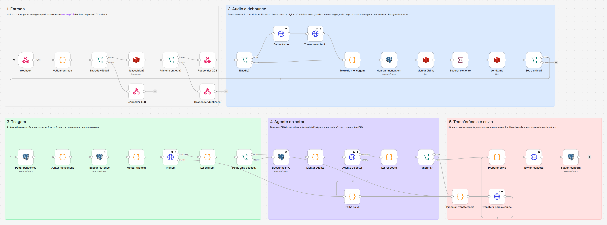
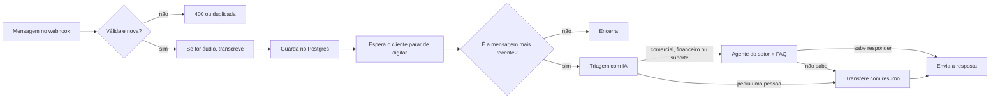

# Chatbot multiagente para WhatsApp com n8n

[](https://github.com/WalissonVinicius/chatbot-multiagente-n8n/actions/workflows/e2e.yml)

Atendimento por WhatsApp com IA em um workflow do n8n. Uma triagem lê a mensagem, escolhe o agente do setor certo (comercial, financeiro ou suporte), o agente responde a partir do FAQ, e a conversa passa para uma pessoa quando precisa.

É uma versão aberta, com dados fictícios, do tipo de chatbot que eu coloco em produção para empresas. A empresa do exemplo é o **Provedor Exemplo**, um provedor de internet inventado.



## O que ele faz

- **Triagem com IA**: classifica cada mensagem em comercial, financeiro, suporte ou "quero falar com uma pessoa".
- **Agentes por setor**: cada setor tem o próprio prompt e responde só com o que está no FAQ dele.
- **Áudio**: transcreve mensagens de voz com o Whisper antes da triagem.
- **Debounce**: espera o cliente parar de digitar e responde tudo de uma vez, em vez de uma resposta por mensagem.
- **Idempotência**: a mesma mensagem entregue duas vezes pelo provedor de WhatsApp não gera duas respostas.
- **Transferência para humano**: manda um resumo da conversa para a equipe, para o cliente não precisar repetir nada.
- **Falha segura**: se a IA cair ou responder fora do formato, a conversa vai para uma pessoa em vez de ficar sem resposta.

## Como funciona



### Decisões que valem explicar

- **Debounce sem perder mensagem.** Cada mensagem é salva no Postgres e marca no Redis qual execução é a mais recente da conversa. Depois da espera, só essa execução segue, e ela pega todas as mensagens pendentes com um único `UPDATE ... RETURNING`. Como o `UPDATE` é atômico, uma mensagem que chega no meio do caminho nunca é apagada nem respondida duas vezes.
- **FAQ com a busca textual do Postgres.** Para algumas dezenas de perguntas, `tsvector` com o dicionário em português resolve sem banco vetorial. Se o FAQ crescer, basta trocar a consulta do nó *Buscar no FAQ* por pgvector, sem mexer no resto.
- **Saída em JSON validada.** A triagem e os agentes respondem em JSON, e qualquer resposta fora do formato vira transferência para uma pessoa.
- **LLM por HTTP.** O modelo é chamado pela API de chat da OpenAI, então funciona também com serviços compatíveis com ela: basta trocar `OPENAI_BASE_URL` e `OPENAI_MODEL`.

## Como rodar

Precisa de Docker.

```bash
cp .env.example .env     # preencha N8N_ENCRYPTION_KEY, OPENAI_API_KEY, REPLY_URL e HANDOFF_URL
docker compose up -d
./scripts/setup.sh       # importa as credenciais e o workflow e publica o workflow
```

O webhook fica em `http://localhost:5678/webhook/chatbot`:

```bash
curl -X POST http://localhost:5678/webhook/chatbot \
  -H "Content-Type: application/json" \
  -d '{"conversationId": "5566999990000", "text": "Quero a segunda via do boleto"}'
```

| Campo | Obrigatório | O que é |
|---|---|---|
| `conversationId` | sim | Identificador da conversa, por exemplo o número do cliente |
| `type` | não | `text` (padrão) ou `audio` |
| `text` | se for texto | A mensagem do cliente |
| `audioUrl` | se for áudio | URL do arquivo de áudio |
| `messageId` | não | ID da mensagem no provedor. Evita resposta duplicada quando ele reenvia a mesma mensagem |

A resposta sai em `POST REPLY_URL` com `{ conversationId, text }`, e a transferência em `POST HANDOFF_URL` com `{ conversationId, setor, resumo, historico }`.

### Ligando no WhatsApp

O workflow não depende de um provedor específico. Para usar com WAHA, Evolution API ou Chatwoot, ajuste:

- **Validar entrada**: converta o webhook do provedor para o formato da tabela acima.
- **Enviar resposta** e **Transferir para a equipe**: aponte para a API do provedor, ou use `REPLY_URL` e `HANDOFF_URL` com um serviço seu que faça essa ponte.

## Testes

O teste de ponta a ponta sobe tudo com um LLM e um WhatsApp falsos (`test/fake-services.mjs`) e confere sete cenários: entrada inválida, triagem, mensagem duplicada, debounce, áudio, pedido de pessoa e falha da IA. Ele roda no GitHub Actions a cada push.

```bash
docker compose --env-file test/test.env --profile test up -d
./scripts/setup.sh --env-file test/test.env --profile test
node test/e2e.mjs
```

O LLM falso responde de forma previsível para testar o fluxo, não a qualidade das respostas. Com uma chave de verdade, o mesmo fluxo usa o modelo real.

## Estrutura

```
workflows/chatbot-multiagente.json   workflow do n8n
db/init.sql                          tabelas e FAQ fictício
credentials/local.json               credenciais do Redis e do Postgres do compose
scripts/setup.sh                     importa e publica o workflow
test/                                serviços falsos e teste de ponta a ponta
```

## Antes de usar em produção

- Troque a senha do Postgres no `docker-compose.yml` e em `credentials/local.json`.
- Proteja o webhook, com autenticação no nó *Webhook* ou um proxy na frente.
- Troque o FAQ fictício pelo da sua empresa em `db/init.sql`.

## Licença

MIT. Feito por [Walisson Vinicius](https://www.walisson.dev).
